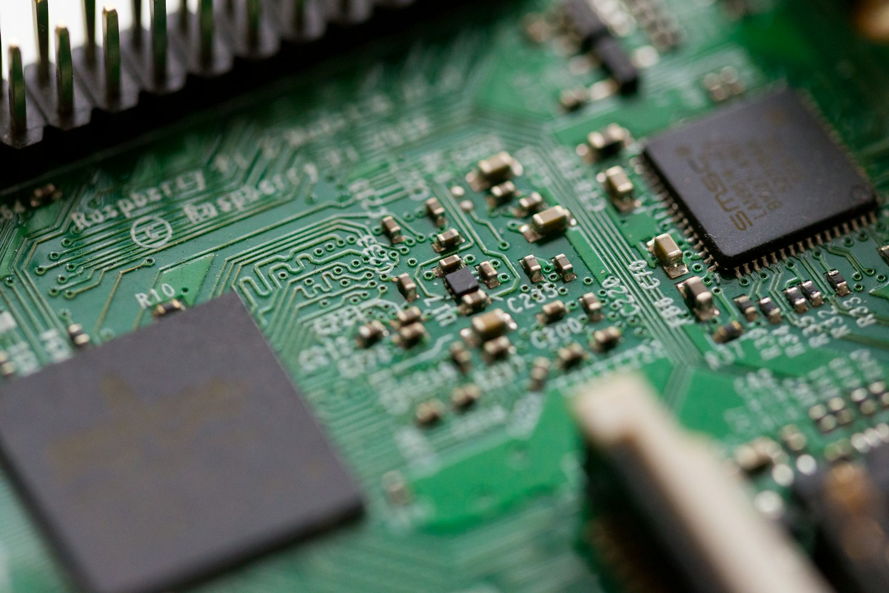

<!-- _class: cover -->
<!-- Replace this decorative photo with your own lab photo if desired. -->

# 實驗室研究進度

研究主題 / Project title

姓名 · 實驗室名稱
2026 / 10 / 10

<!-- Decorative image: Chris Ried, Unsplash, https://unsplash.com/photos/bN5XdU-bap4. This is a sample photo, not an experiment result. -->

---

# 研究目標

- **研究問題：** 在這裡寫下本次想回答的問題。
- **評估方法：** 說明實驗條件與比較基準。
- **本週進度：** 寫下完成的項目與待確認的問題。

<!-- Replace these prompts with your actual research content. -->

---

# 實驗條件與結果

| 項目 | 設定 / 結果 | 備註 |
| --- | --- | --- |
| 測試環境 | 待填寫 | 設備、版本或量測條件 |
| 比較基準 | 待填寫 | 參考方法或上週結果 |
| 主要指標 | 待填寫 | 數值、單位與誤差 |

**觀察：** 在這裡寫一個由資料支持的結論。

---

# 量測圖片

<!-- Put your own image in slides/assets and replace the path below. -->

圖片示例：請替換成波形、實驗設備照片或結果圖，並補上單位。

<!-- Sample image: Chris Ried, https://unsplash.com/photos/bN5XdU-bap4. -->

---

# 公式與後續工作

<!-- Marp renders LaTeX formulas using KaTeX in both preview and export. -->
$$
\mathrm{SNR}_{\mathrm{dB}} = 10\log_{10}\left(\frac{P_{\mathrm{signal}}}{P_{\mathrm{noise}}}\right)
$$

- 下一次實驗：待填寫。
- 尚待確認：待填寫。
- 討論事項：待填寫。
