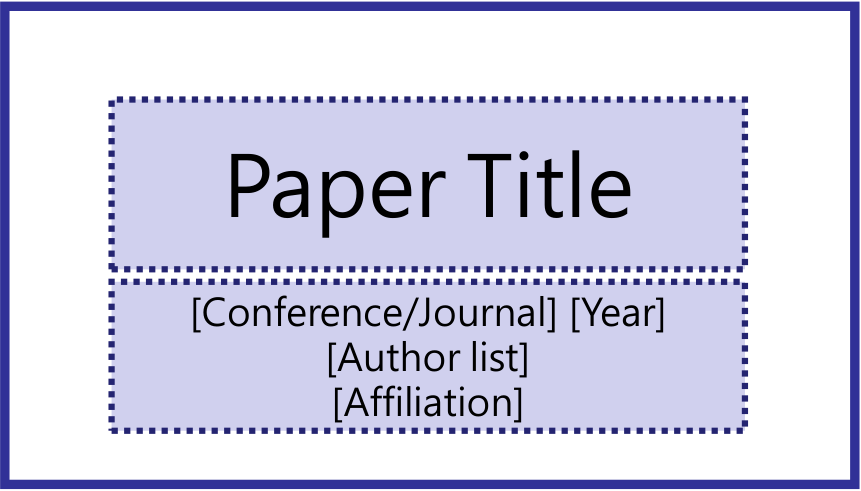
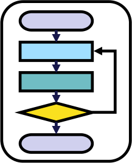
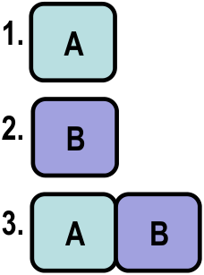
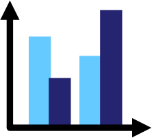
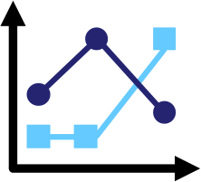
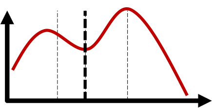

# **How to Do Paper Presentation** 

**Speaker: Ning-Chi Huang** 

CAAT LAB Department of Electrical Engineering National Cheng Kung University 

--- end of page.page_number=1 ---

## **Outline** 

◼ **What is paper presentation** 

- **Tips to give a paper presentation** 

- **Tips to prepare a paper presentation** 

- ◼ **Summary** 

2 

--- end of page.page_number=2 ---

# **What is Paper Presentation** 

3 

--- end of page.page_number=3 ---

# **Is there anyone who has not ever given an oral presentation?** 

4 

--- end of page.page_number=4 ---

## **What is Paper Presentation** 

◼ **An oral presentation for** 

   - ➢ **Completed project(s)** 

   - ➢ **Research paper(s)** 

   - ➢ **Research findings, ideas, or information** 

- **In a structured and formal manner** 

◼ **Usually include a visual aid** ➢ **E.g., slides** 

5 

--- end of page.page_number=5 ---

## **How to Give an Effective Paper Presentation?** 

- **During the presentation** 

   - ➢ **Remember that you are delivering information to your audience!** 

- **Before the presentation** 

   - ➢ **Prepare a good PPT** 

   - ➢ **Remember that you will deliver information to your audience!** 

6 

--- end of page.page_number=6 ---

# **Tips to Give a Paper Presentation** 

7 

--- end of page.page_number=7 ---

## **Tips** 

◼ **Know your audience** 

➢ **Provide appropriate depth and information** 

   - ➢ **Engage your audience** 

   - ➢ **Make eye contact** 

- **Use audio and visual material** 

   - ➢ **to supplement your information** 

- **Present within your allotted time** 

**? ? !** 

8 

--- end of page.page_number=8 ---

# **Tips to Prepare Paper Presentation** 

- **Content in PPT** 

- **Steps to prepare PPT** 

- **Some tips** 

9 

--- end of page.page_number=9 ---

## **Structure of Paper Presentation** 

- **Title** 

- **Background & motivation** 

- **Methods** 

- **Experimental settings & results** 

- **Discussion** 

- **Conclusions** 

◼ **Q&A** 

10 

--- end of page.page_number=10 ---

## **Title Slide** 

### ◼ **Title should include** 

   - ➢ **Paper title or topic you are going to talk** 

   - ➢ **Your name** 

   - ➢ **Your affiliation** 

   - ➢ **Appropriate logos** 

- **When you present a paper** 

   - ➢ **Conference/Journal & Year** 

   - ➢ **Information about the authors** 

11 

--- end of page.page_number=11 ---

## **Title Slide – Examples** 

**For paper presentation** 

<!-- Start of picture text -->
Paper Title [Conference/Journal] [Year] [Author list] [Affiliation] <!-- End of picture text -->

### **For progress presentation** 

<!-- Start of picture text -->
Research Topic Speaker: [Your Name] Advisor: 黃寗琪教授 <!-- End of picture text -->

12 

--- end of page.page_number=12 ---

## **Slides for Background & Motivation** 

### ◼ **Define the problem** 

◼ **Explain why the problem is so important** 

◼ **Introduce terminology** 

◼ **Discuss earlier work** 

◼ **Show the research gap** 

13 

--- end of page.page_number=13 ---

## **Slides for Methods** 

### ◼ **Describe the method in a logical order** 

   - ➢ **Top-down or bottom-up** 

- **Explain why and how the method works** 

   - ➢ **With visual aid, e.g., figures, tables, or even animation in PPT!** 

- **Emphasize the contributions of your paper** 

   - ➢ **Novelty or the research gap you fill** 

<!-- Start of picture text -->
1. A 2. B 3. A B <!-- End of picture text -->

14 

--- end of page.page_number=14 ---

## **Slides for Experimental Results** 

◼ **Include descriptive results and analytic results** 

◼ **Use mixture of text, tables, figures, photos as appropriate to your data** ◼ **Explain the significance of the results** 

15 

--- end of page.page_number=15 ---

## **Slides for Discussion & Conclusions** 

- **Interpretation of findings** 

   - ➢ **Prioritize findings from most to least important** 

   - ➢ **Link findings to study objectives** 

   - ➢ **Put findings into context with previous studies** 

- **Limitations slide (only the important ones)** 

◼ **Conclusions slide(s) based on your findings** 

- **Recommendations slide(s)** 

   - ➢ **Directions for future studies** 

16 

--- end of page.page_number=16 ---

# **Tips to Prepare Paper Presentation** 

- **Content in PPT** 

- **Steps to prepare PPT** 

- **Some tips** 

17 

--- end of page.page_number=17 ---

## **Steps to Prepare a PPT** 

### **1. Think** 

   - ➢ **What to say – select material to include** 

   - ➢ **How to say it – arrange material in a logical order** 

   - ➢ **How much time to talk – ensure budget of time/pages of PPT** 

**2. Collect material and arrange them** 

   - ➢ **From the paper to present** 

- ➢ **Maybe figures from the internet – explain background knowledge more clear!** 

- **3. Check & practice** 

   - ➢ **Font size, spelling, caption, …ensure all text, figure and ideas are clear!** 

18 

--- end of page.page_number=18 ---

# **Tips to Prepare Paper Presentation** 

- **Content in PPT** 

- **Steps to prepare PPT** 

- **Some tips** 

19 

--- end of page.page_number=19 ---

## **General Tips** 

### ◼ **Be brief and concise** 

➢ **K.I.S.S (Keep it short and simple)** 

◼ **Focus on the subject** 

◼ **Attract attention** 

➢ **Make clear statements about the essence/results of the topic/research** ◼ **If possible, use** **_relevant_ visual illustrations** 

➢ **Pictures, maps, charts graphs, etc.** 

➢ **Explain what each chart or graph indicates** 

20 

--- end of page.page_number=20 ---

## **Effective Text Slides** 

- **Order of slide text matches order of script** 

- **Keywords only, not complete sentences** 

   - ➢ **Use bullets or numbers to structure the text** 

- **8–10 lines maximum** 

- **Parallel structure (all verbs, all nouns, etc.)** 

   - ➢ **Verbs: improve, enhance, produce, …** 

   - ➢ **Gerunds: improving, enhancing, producing, …** 

   - ➢ **Nouns: improvement, enhancement, product, …** `）` 

21 

--- end of page.page_number=21 ---

## **Recommended Fonts and Sizes** 

### ◼ **Sans serif font, all titles and text bolded** 

➢ **E.g., Arial, Tahoma** 

➢ **Have simple, high-contrast, consistent** 

◼ **For Arial (bolded):** 

   - ➢ **Titles 36 pt** 

   - ➢ **Main bullets 28 pt** 

   - ➢ **Sub-bullets 28 pt if room, otherwise 24 pt** 

   - ➢ **Avoid sub-sub bullets (re-format)** 

- **Keep text / title size consistent across slides** 

   - ➢ **Stop PowerPoint from changing text size as you type** 

<!-- Start of picture text -->
[Title] (~36pt) <!-- End of picture text -->

- 第一層文字(~28pt) • 第二層文字(~24pt) • 不要用到第三層， 字會太小 [#] 

22 

--- end of page.page_number=22 ---

## **Things to Avoid** 

◼ **Visual clutter from too many colors** 

- Unbolded, serif font like Times New Roman 

- **ALL CAPS (HARD ON THE EYES)** 

- **Animation** 

   - ➢ **no flying objects** 

- **Clip art that serves no purpose** 

- **Unnecessary grid lines in figures** 

- **Necessary lines that are too thin** 

23 

--- end of page.page_number=23 ---

## **Things to Check** 

### ◼ **Use informative titles** 

➢ **“Architecture of our proposed approximate adder”** 

- ➢ **“Comparison of area overhead for different adders”** 

➢ **Not “Results 1, “Results 2”** 

- **Use high quality images** 

◼ **Use consistent font** 

24 

--- end of page.page_number=24 ---

# **Summary** 

25 

--- end of page.page_number=25 ---

## **Summary** 

◼ **Remember that you are delivering information to the audience** 

◼ **Well organized, practiced presentation with clear, effective slides** 

➢ **Appropriate depth, logical order, visual aid** 

➢ **Simple and clear** 

26 

--- end of page.page_number=26 ---

# **Thank you!** 

27 

--- end of page.page_number=27 ---

## **Reference** 

◼ **urca.msu.edu** 

- **https://dornsife.usc.edu/assets/sites/605/docs/Tips_10_minute_Scientifi c_PowerPoint_Presentation_Meds_490.pdf** 

◼ **https://guides.library.ucla.edu/c.php?g=180334&p=1188045** 

28 

--- end of page.page_number=28 ---

